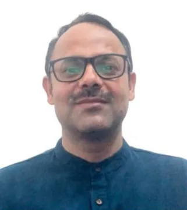

  

    RESEARCH GROUP
    <h1>High-Performance and Trustworthy AI Systems Lab</h1>
    

      उच्च प्रदर्शन एवं विश्वसनीय कृत्रिम बुद्धिमत्ता प्रणाली प्रयोगशाला
    

    

    

      Advancing secure, privacy-preserving, robust and trustworthy
      artificial intelligence through research, innovation and collaboration.
    

  

<!-- FACULTY -->

<section class="lab-section">

  

    

      OUR PEOPLE
      <h2>Faculty & Mentors</h2>
      
Faculty members guiding research and academic activities.

    

  

  

    

      

        
      

      

        <h3>Prof. Ravi Shankar Singh</h3>
        
Professor

        Faculty Mentor
      

    

    

      

        
      

      

        <h3>Dr. Harsh Kasyap</h3>
        
Assistant Professor

        Lab Coordinator
      

    

  

</section>

<!-- PHD SCHOLARS -->

<section class="lab-section">

  

    

      DOCTORAL RESEARCH
      <h2>Ph.D. Scholars</h2>
      
Researchers pursuing doctoral studies.

    

    05 Scholars
  

  

    

      
01

      

        <strong>Kumar Anubhav</strong>
      

      Ph.D. Scholar
    

    

      
02

      

        <strong>Himanshi Bansal</strong>
        <small>Co-supervisor: Dr. Indra Deep Mastan</small>
      

      Ph.D. Scholar
    

    

      
03

      

        <strong>Nitin Chauhan</strong>
      

      Ph.D. Scholar
    

    

      
04

      

        <strong>Ritesh Mishra</strong>
        <small>Co-supervising with Dr. Indra Deep Mastan</small>
      

      Ph.D. Scholar
    

    

      
05

      

        <strong>Utkarsh Singh</strong>
        <small>Co-supervising with Prof. Ravi Shankar Singh</small>
      

      Ph.D. Scholar
    

  

</section>

<!-- JRF -->

<section class="lab-section">

  

    

      RESEARCH STAFF
      <h2>Junior Research Fellow</h2>
      
Research personnel associated with ongoing projects.

    

  

  

    

      
01

      

        <strong>Mohit Kumar Attri</strong>
        <small>Since November 2026</small>
      

      JRF
    

  

</section>

<!-- MTP STUDENTS -->

<section class="lab-section">

  

    

      POSTGRADUATE RESEARCH
      <h2>M.Tech. Project Students</h2>
      
Students undertaking postgraduate research projects.

    

  

  

    

      <button class="batch-tab active"
              type="button"
              role="tab"
              aria-selected="true"
              data-tab="mtp-2026">
        2026–27
        Current
      </button>

      <button class="batch-tab"
              type="button"
              role="tab"
              aria-selected="false"
              data-tab="mtp-2025">
        2025–26
      </button>

    

    

      

        

          01
          <h3>Amit Kumar Maurya</h3>
          M.Tech. Project Student
        

        

          02
          <h3>Yash Sharma</h3>
          M.Tech. Project Student
        

        

          03
          <h3>Parteek Yadav</h3>
          M.Tech. Project Student
        

        

          04
          <h3>Pranjul Malpani</h3>
          M.Tech. Project Student
        

      

    

    

      

        

          01
          <h3>Thansen Dhrit Lahare</h3>
          M.Tech. Project Student
        

        

          02
          <h3>Navneet Panchayan</h3>
          M.Tech. Project Student
        

      

    

  

</section>

<!-- BTP STUDENTS -->

<section class="lab-section">

  

    

      UNDERGRADUATE RESEARCH
      <h2>B.Tech. Project Students</h2>
      
Undergraduate students working on research and project activities.

    

  

  

    

      <button class="batch-tab active"
              type="button"
              role="tab"
              aria-selected="true"
              data-tab="btp-2026">
        2026
        Current
      </button>

    

    

      

        

          01
          <h3>Shreyansh Solanki</h3>
          B.Tech. Project Student
        

        

          02
          <h3>Drish Menghani</h3>
          B.Tech. Project Student
        

        

          03
          <h3>Dhanish Shetty</h3>
          B.Tech. Project Student
        

        

          04
          <h3>Aaditya Agarwal</h3>
          B.Tech. Project Student
        

        

          05
          <h3>Mansi Jamwal</h3>
          B.Tech. Project Student
        

        

          06
          <h3>Kush</h3>
          B.Tech. Project Student
        

        

          07
          <h3>Killari Nandini</h3>
          B.Tech. Project Student
        

      

    

  

</section>

<!-- EXPLORATORY STUDENTS -->

<section class="lab-section">

  

    

      RESEARCH EXPLORATION
      <h2>Exploratory Students</h2>
      
Students exploring research problems and gaining experience in academic research.

    

  

  

    

      <button class="batch-tab active"
              type="button"
              role="tab"
              aria-selected="true"
              data-tab="explore-2026">
        2026
        Current
      </button>

    

    

      

        

          01
          <h3>Anju</h3>
          Exploratory Student
        

        

          02
          <h3>Garvita Gigras</h3>
          Exploratory Student
        

        

          03
          <h3>Geetanjali</h3>
          Exploratory Student
        

        

          04
          <h3>Ghanendar</h3>
          Exploratory Student
        

        

          05
          <h3>Hansraj</h3>
          Exploratory Student
        

        

          06
          <h3>Haraskumar</h3>
          Exploratory Student
        

        

          07
          <h3>Himani Prakash</h3>
          Exploratory Student
        

        

          08
          <h3>Kamlesh Kumawat</h3>
          Exploratory Student
        

      

    

  

</section>

<!-- RESEARCH INTERNS -->

<section class="lab-section">

  

    

      RESEARCH PARTICIPATION
      <h2>Research Interns</h2>
      
Students regularly contributing to ongoing research activities and projects.

    

  

  

    

      01
      <h3>Aadi</h3>
      Research Intern
    

    

      02
      <h3>Aaditya</h3>
      Research Intern
    

    

      03
      <h3>Suryansh</h3>
      Research Intern
    

    

      04
      <h3>Shreyansh</h3>
      Research Intern
    

  

</section>

<!-- FOOTNOTE -->

  <strong>About the student directory</strong>
  

    This page provides an overview of students and researchers
    associated with the lab. The list is periodically updated.
    If we have missed anyone who is regularly contributing to
    our research activities, please get in touch so that the
    information can be updated.
  

